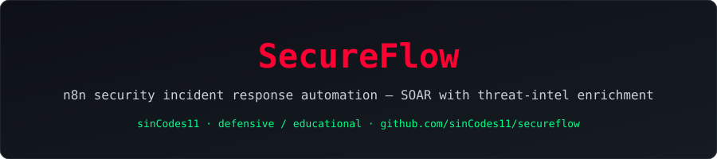
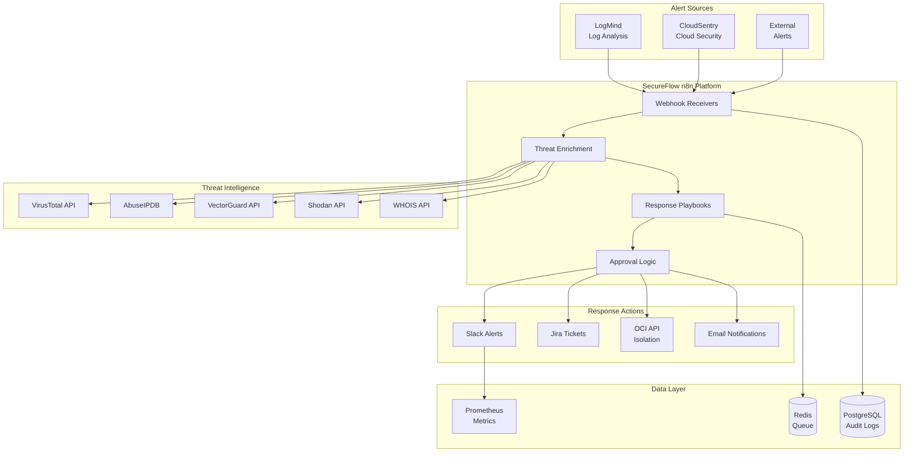

<div align="center">
  
</div>

<p align="center">
  
  
  
</p>


<p align="center">
  
  
  
</p>

Automated security incident response platform built on n8n — processes alerts from LogMind, CloudSentry, and external sources, enriches them with threat intelligence, and executes response playbooks in under 5 seconds.

## Architecture



## Components

### n8n Workflow Engine
- **Webhook Receivers** — HTTP endpoints for LogMind, CloudSentry, external alerts
- **Threat Enrichment Nodes** — Parallel API calls across VirusTotal, AbuseIPDB, Shodan, WHOIS
- **Response Playbooks** — Automated incident workflows per threat category
- **Approval Logic** — Human-in-the-loop gate for destructive actions

### Playbook Library

| # | Playbook | Trigger |
|---|----------|---------|
| 1 | Malware Detection Response | Hash match, file alert |
| 2 | Brute Force Mitigation | Failed auth threshold |
| 3 | Data Exfiltration Investigation | Anomalous outbound traffic |
| 4 | Cloud Misconfiguration Remediation | CloudSentry finding |
| 5 | Phishing Email Analysis | Suspicious sender/URL |
| 6 | Suspicious Login Investigation | Geo/device anomaly |

### Integration Layer
- **Threat Intel APIs** — VirusTotal, AbuseIPDB, Shodan, WHOIS
- **Internal APIs** — VectorGuard threat query, OCI cloud operations
- **Communication** — Slack notifications, Jira ticket creation

### Data Layer
- **PostgreSQL** — Audit trails, incident history, SLA metrics
- **Redis** — Message queuing, workflow state
- **Prometheus** — Performance metrics, success rates, response times

## Technology Stack

| Component | Technology |
|-----------|------------|
| Workflow Engine | n8n |
| Orchestration | Docker Compose |
| Database | PostgreSQL |
| Queue | Redis |
| Mock Services | Python + Flask |
| Proxy | Nginx |

## Quick Start

### Prerequisites
- Docker & Docker Compose
- Git

```bash
git clone https://github.com/sinCodes11/secureflow SecureFlow
cd SecureFlow

cp .env.example .env
# Edit .env with your settings

docker-compose up -d

# Access n8n at http://localhost:5678
# Import workflows from /workflows/
```

## Security Model

- n8n user auth + API key validation on all webhook endpoints
- Webhook input sanitization and rate limiting
- Secrets via environment variables (Vault-ready)
- Complete audit trail for every automated action

## Performance Targets

| Metric | Target |
|--------|--------|
| Alert enrichment time | < 5 seconds |
| Throughput | 100+ incidents/hour |
| SLA acknowledgement | 95% within 2 minutes |

## Repository Structure

```
SecureFlow/
├── docker-compose.yml
├── .env.example
├── workflows/
│   ├── malware-response.json
│   ├── brute-force-mitigation.json
│   ├── data-exfiltration.json
│   ├── cloud-remediation.json
│   ├── phishing-analysis.json
│   └── suspicious-login.json
├── mock-apis/
│   ├── app.py
│   ├── requirements.txt
│   └── Dockerfile
├── database/
│   ├── init.sql
│   └── audit-schema.sql
├── docs/
│   ├── playbook-guide.md
│   └── api-integration.md
└── scripts/
    ├── setup.sh
    └── generate-test-data.py
```

## License

MIT
